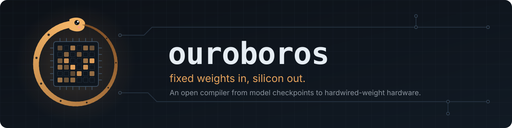

  

  
  
  

**ouroboros** is an open-source compiler that turns a trained neural network, with its weights frozen, into hardware built specifically for that one model. You feed it a checkpoint. It gives you synthesizable RTL, a verification suite and, eventually, a layout ready for fabrication, with the weights built into the circuit itself.

> [!NOTE]
> **Status: design phase.** No working compiler yet. This repository currently holds the design, the requirements and the roadmap. The first milestone, a tiny MLP compiled end to end and verified bit-exact, is described in [ROADMAP.md](ROADMAP.md).

## Why

Most of the AI compute people pay for is **inference**, and inference runs on **fixed weights**. Deployed models don't learn online. Yet they run on GPUs and accelerators that are built to be general: able to run any model, any architecture, any weights loaded at runtime. That generality costs silicon area, power and, above all, data movement: every generated token streams the whole model's weights from off-chip memory to the compute units.

If the weights never change, most of that is unnecessary. A multiply by a known constant isn't a general multiplier. It's a few shifts and adds. A zero weight isn't a computation at all. Weights can sit right next to the logic that uses them, so they never have to be fetched. Commercial work on model-specific silicon has shown order-of-magnitude gains in speed and efficiency with this approach. The tools for doing it are proprietary.

ouroboros is meant to be the **open** version: a compiler anyone can read, run, extend and benchmark. The long-term optimization target is **useful intelligence per joule and per euro**, not raw arithmetic throughput.

There's also a sovereignty argument. A model compiled into your own silicon is inference capacity no one can revoke, reprice or change underneath you.

## How

What separates it from a generic accelerator generator is that **the compiler exploits the fact that the weights are constants**:

- **Constant-coefficient arithmetic.** Multiplications by known weights become shift-and-add networks, with partial products shared across a row.
- **Zero-weight elimination.** Pruned or quantized-to-zero weights produce no hardware.
- **Weights as storage next to compute.** For larger layers, weights live in mask ROM placed right beside the multipliers that use them, with no memory bus.
- **A spatial ↔ temporal dial.** Each layer can be fully unrolled (fast, large) or time-multiplexed over shared units (small, slower). The compiler searches this space per layer.
- **Hardwire the weights, keep the glue programmable.** Nearly all fixed weights sit in linear operations. Norms, activations and attention are small in compute and can run on a small programmable unit. That keeps the compiler open to new architectures.

Correctness comes first. Every stage is checked bit-exact against an executable golden model that defines the numerics. See [docs/verification.md](docs/verification.md).

## Scope

**In scope:** any model whose weights are fixed after training and whose operations are in the op library. New ops plug in. Phase I targets MLPs, Phase II small transformers, and Phase III mixture-of-experts and multi-die designs.

**Out of scope:** online learning, weights that change during operation, and neuromorphic hardware. Also out of scope: building a general programmable accelerator. If the weights aren't constants, this is the wrong tool.

**Reality check:** open process kits (sky130, GF180, IHP SG13G2) are many times less dense than the leading-edge nodes commercial chips use. The near-term targets are small models, simulation, FPGAs and small shuttle runs. The compiler is the product. The process node is a backend setting.

## Documentation

| Document | Contents |
|---|---|
| [docs/architecture.md](docs/architecture.md) | IR layers, the op / state / control abstractions, mapping strategy, backends |
| [docs/requirements.md](docs/requirements.md) | Numbered requirements (`CMP`, `OPT`, `NUM`, `VER`, …) and the phase each one belongs to |
| [docs/verification.md](docs/verification.md) | Golden model, bit-exact checking, equivalence, fault injection, measurement |
| [docs/toolchain.md](docs/toolchain.md) | The free and open-source EDA tools ouroboros builds on |
| [ROADMAP.md](ROADMAP.md) | Phases, milestones and research tracks |

## Contributing

Contributions are welcome, especially from people with backgrounds in compilers, digital design, EDA, numerics or device physics. Read [CONTRIBUTING.md](CONTRIBUTING.md) first. The short version: **verification decides whether a change is done.** A pass that isn't checked against the golden model isn't finished.

Good first areas, once code exists: new ops for the library, verification tooling, cost models calibrated against real place-and-route runs.

## License

[Apache License 2.0](LICENSE). The RTL, layouts and other artifacts **produced by** the compiler belong to whoever ran it. The license covers ouroboros itself, not your outputs.
